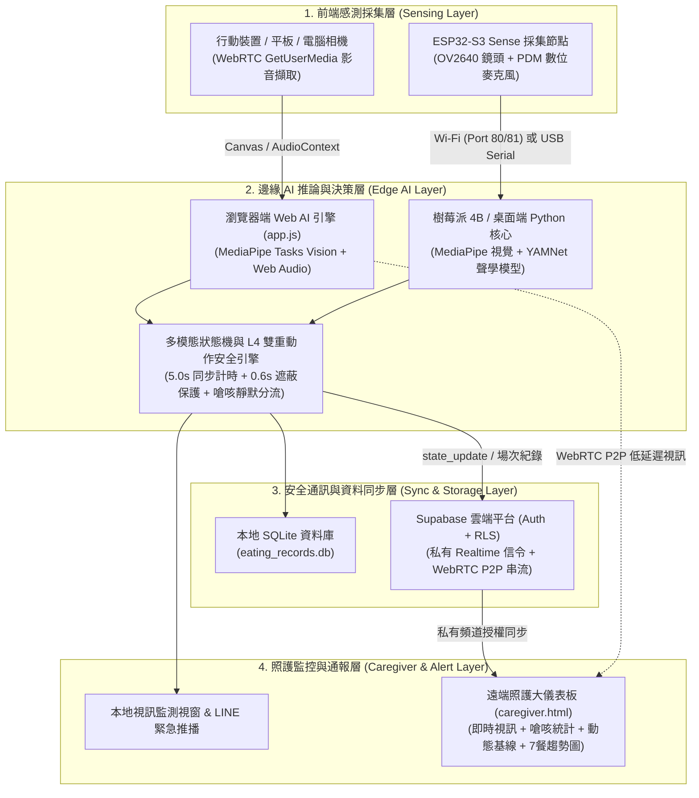
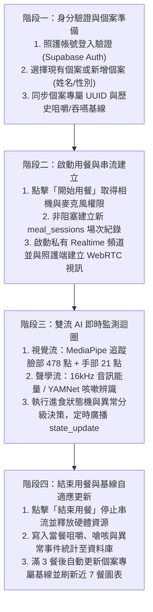
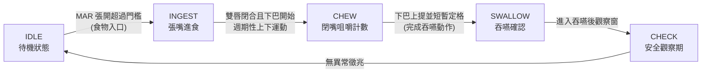
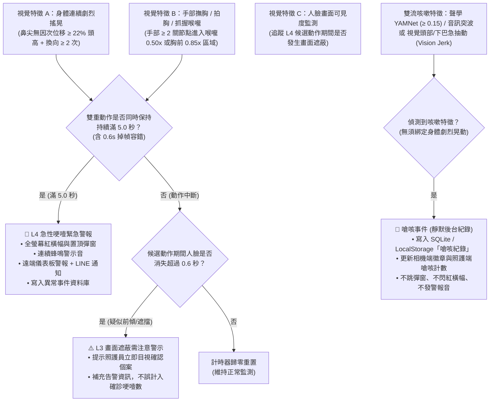

# 🛡️ 防哽咽即時監測系統 —— 專案運作流程與系統架構說明

**專案名稱**：基於多模態邊緣運算與跨網域即時串流之防哽咽預警系統  
**文件目的**：完整說明本專案之硬體與雲端雙軌系統架構、端到端運作流程、多模態 AI 進食與防哽咽判定邏輯，以及核心程式模組與資料流設計。

---

## 📐 一、系統整體架構（System Architecture）

本系統採用 **「前端非接觸式影音感測 ＋ 邊緣多模態 AI 即時推論 ＋ 雙軌部署（本地硬體端／跨網域 Web 端）＋ 分級照護通報」** 架構，兼顧機構邊緣運算獨立運作與行動裝置跨網域遠端監看需求。



### 1. 本地邊緣硬體架構（ESP32-S3 ＋ Raspberry Pi 4B ／ PC 桌面端）

| 節點名稱 | 硬體／環境規格 | 核心職責與通訊方式 |
| :--- | :--- | :--- |
| **前端採集節點** | Seeed Studio XIAO ESP32S3 Sense（雙核 240MHz、8MB PSRAM、OV2640 鏡頭、PDM 麥克風） | 即時擷取進食者頭頸胸畫面與 16kHz 呼吸／咳嗽音訊；支援 **方案 A（USB CDC 序列埠二進位封包多工）** 與 **方案 B（Wi-Fi 熱點 Port 80 MJPEG + Port 81 PCM）** 雙模式傳輸。 |
| **邊緣運算核心** | Raspberry Pi 4B（aarch64，獨立 Python 3.12 環境）或 Windows 桌面端電腦 | 執行 MediaPipe 臉部／手部／姿態關鍵點辨識、Google YAMNet 咳嗽聲學分類、L4 雙重動作計時決策、SQLite 本地紀錄寫入與 LINE 緊急廣播。 |
| **本地監控介面** | OpenCV / Tkinter 即時視窗與內網 Web 控制台（Port 8080） | 即時繪製紅色嘴部輪廓（20 點）、粉紅色喉嚨感應圈與橘黃色 21 點手部骨架，於 L4 緊急哽噎時彈出置頂視窗並驅動蜂鳴音效。 |

### 2. 跨網域 Web 即時照護架構（相機端 ＋ Supabase ＋ 遠端儀表板）

| 系統層級 | 對應模組檔案 | 核心技術與安全機制 |
| :--- | :--- | :--- |
| **被照護者相機端** | `mobile/index.html`、`mobile/app.js`、`mobile/auth-ui.js` | 於手機／平板瀏覽器本地執行 MediaPipe `FaceLandmarker` 與 `HandLandmarker`，具備個案切換／快速新增帳號、開始與結束用餐控制，以及「📋 嗆咳紀錄」檢視面板。 |
| **安全信令與雲端資料庫** | `mobile/connection-core.js`、`supabase/migrations/` | 採用 Supabase Auth 身分驗證與 PostgreSQL Row-Level Security（`owner_id = auth.uid()`），以個案專屬 UUID 建立私有頻道 `anti-choke:{profile_uuid}`，阻絕未授權存取。 |
| **WebRTC P2P 影音串流** | `RTCPeerConnection` ＋ ICE Candidate Buffer | 照護端訂閱私有頻道後發送 `request_offer`，相機端即時回傳 WebRTC Offer 並透過 Negotiation Gate 序列化協商與緩衝早期 ICE 候選位址，實現跨網域低延遲視訊監看。 |
| **遠端照護大儀表板** | `mobile/caregiver.html`、`mobile/caregiver.js` | 提供登入帳號專屬個案下拉選單、即時 WebRTC 畫面、當餐嗆咳事件計數、3 餐自適應動態基準校正面板（$\mu \pm \sigma$）、即時異常事件日誌與 Chart.js 近 7 餐趨勢圖表。 |

---

## 🔄 二、系統端到端運作流程（End-to-End Workflow）

系統從啟動、用餐監測到餐後歸檔分為四個標準階段，確保照護流程順暢且資料庫紀錄具備單一場次隔離性：



### 各階段關鍵設計細節

1. **階段一（身分驗證與個案準備）**：
   * 相機端與照護端須登入同一照護帳號，系統透過 RLS 確保僅能讀取該帳號名下之 `patient_profiles`。
   * 支援於介面直接新增被照護者（輸入稱呼與性別），自動配發代碼（如 `P004`）並同步建立雲端個案檔案。
2. **階段二（啟動用餐與非阻塞建檔）**：
   * 採用同步啟動鎖（`createStartLock`）防止重複點擊造成多重相機串流競爭；若媒體授權部分失敗，會自動關閉已取得之音視訊軌並安全釋放資源。
   * 資料庫新增場次（`mealSessionTracker.begin`）採背景非阻塞執行，AI 影像監測與 WebRTC 信令可立即啟動，不因網路延遲卡住畫面。
3. **階段三（即時監測與跨端同步）**：
   * 每一影格完成視覺與聲學特徵推論後，除了更新本地狀態提示外，亦透過私有頻道推播 `state_update` 封包至遠端照護儀表板，同步更新嗆咳次數與緊急警報橫幅。
4. **階段四（結束用餐與歷史趨勢校正）**：
   * 點擊「結束用餐」後先停止監測迴圈與視訊軌，再等待當餐 `meal_sessions` 寫入完成並更新最終統計數據，杜絕跨餐次 ID 混寫。
   * 前 3 餐套用臨床通用標準（單次咀嚼 `0.85s`、吞嚥停頓 `1.10s`），第 4 餐起依個人歷史平均值自動更新動態基準。

---

## 🧠 三、核心 AI 演算法與異常判定流程（Detection & Decision Logic）

### 1. 自主進食狀態機流程（Eating State Machine）

系統追蹤嘴唇開合比（Mouth Aspect Ratio, `MAR`）與下巴關鍵點垂直運動軌跡，將每一口進食拆解為五個狀態：



* **友善長者進食設計**：已全面停用舊版「咀嚼停頓或發呆滿 4 秒警報」以及「無聲窒息單獨觸發旁路」，讓長者能依自身節奏安心細嚼慢嚥，避免誤報造成用餐焦慮。

### 2. 多模態哽噎與嗆咳分級判定流程

系統結合 **視覺空間幾何、時間序列位移反轉分析、手部關鍵點追蹤與聲學咳嗽偵測**，執行嚴格的三路分流決策：



### 3. 關鍵特徵量化指標定義

#### (1) 尺度不變身體劇烈晃動指標（Scale-Invariant Body Shaking）
* 為避免拍攝距離遠近影響靈敏度，系統追蹤鼻尖關鍵點 $p_4$ 位移量並除以當前人臉高度進行無因次化：
  $$\text{norm\_disp} = \frac{\Delta \text{pos}}{\text{face\_height}}$$
* **觸發條件**：滑動時間窗內無因次振幅 $\ge 22\%$ 頭高、單步像素位移超越死區門檻（$> 3.0\text{ px}$），且具備**至少 $\ge 2$ 次極值方向反轉（Direction Reversals）**，徹底過濾單純低頭夾菜、喝湯或轉頭看人的單向移動。

#### (2) 自適應喉嚨與胸前危險區手勢指標（Adaptive Throat & Chest Zone）
* 以鼻尖至下巴連線向下延伸定義個人化感應區：
  - **喉嚨感應半徑**：$0.50 \times \text{face\_height}$（對應國際通用雙手抓喉窒息手勢）。
  - **胸前感應半徑**：$0.85 \times \text{face\_height}$（涵蓋長者常見之撫胸、拍胸求救動作）。
* 使用 MediaPipe Hand Landmarker 追蹤 21 個手部關節點，至少 $\ge 2$ 個關節點落入危險區方判定為有效手勢。

#### (3) 雙重動作同步計時與視覺遮蔽保護機制
* **5.0 秒雙重確認（`ChokeDoubleActionTimer`）**：唯有「身體劇烈晃動」與「胸前／喉嚨手勢」同時成立時計時器才遞增（允許 $0.6$ 秒內短暫關鍵點閃爍容錯 `grace_sec`），徹底排除拿湯匙送餐經過胸口或摸脖子抓癢的日常動作。
* **視覺遮蔽保護（`FaceLossWarningGuard`）**：若個案已出現晃動＋撫胸候選動作，隨後因痛苦前傾趴桌或手部遮擋導致人臉關鍵點消失超過 $0.6$ 秒，系統立即清除過期軌跡並發出「⚠️ 疑似哽噎・畫面遮蔽需目視確認」警示，兼顧低誤報與高安全性。

---

### 4. 警報與事件分級處置矩陣

| 等級與事件名稱 | 觸發條件組合 | 系統前端與遠端回應方式 |
| :--- | :--- | :--- |
| **🚨 L4 急性哽噎緊急警報**<br/>*(Choking Emergency)* | **手部撫胸／拍胸／抓喉 ＋ 身體前後左右劇烈晃動**，雙重動作同時持續滿 $5.0$ 秒。 | **最高等級緊急通報**：相機端與照護儀表板同步顯示紅色閃爍警報與彈窗、啟動高頻蜂鳴音效、發送 LINE 緊急通知（邊緣端），並寫入異常資料庫。 |
| **⚠️ L3 畫面遮蔽需注意警示**<br/>*(Visibility Warning)* | 已進入 L4 雙重動作候選狀態時，人臉突然離開畫面或遭遮擋超過 $0.6$ 秒。 | **目視確認提醒**：通知照護端「畫面遮蔽無法確認哽噎，請立即查看個案」；若當下已有高優先級警報則附加說明而不降級，且不誤增確診哽噎計數。 |
| **🤫 嗆咳事件紀錄**<br/>*(Silent Cough Log — 原 L1/L2 合併)* | 聲學模型偵測咳嗽（YAMNet $\ge 0.15$ 或音訊能量突波）或影像頭部／下巴急抽動（**無須綁定劇烈晃動**）。 | **零干擾靜默紀錄**：僅於背景寫入 SQLite／LocalStorage（標籤 `嗆咳紀錄`）並遞增畫面嗆咳計數徽章，**絕不跳出彈窗、不閃紅橫幅、不發警報聲**。 |

---

## 💻 四、專案模組結構與資料表設計（Modules & Data Schema）

### 1. 核心程式碼模組對照

```text
Chang-Gung/長庚/
├── 桌面版_學生註解/桌面版_學生註解/          # 本地邊緣運算 Python 端與硬體串流韌體
│   ├── 防哽咽裝置4_2.py                     # 桌面/樹莓派主程式 (OpenCV + MediaPipe + YAMNet + SQLite)
│   ├── l4_safety.py                         # L4 雙重動作 5 秒計時器與人臉遮蔽保護模組
│   ├── gesture.py / evidence_fusion.py      # 喉嚨手勢幾何計算與多模態時間窗特徵融合模組
│   ├── pc_receiver_ui.py                    # 接收 ESP32-S3 影音串流之本地監控介面
│   └── esp32_wifi_streamer/                 # Seeed XIAO ESP32S3 FreeRTOS 雙核影音串流韌體
│
└── online-work/                             # 跨網域 Web 端與雲端同步系統
    ├── mobile/index.html                    # 被照護者相機端介面 (極簡化監測視窗 + 嗆咳紀錄面板)
    ├── mobile/app.js                        # 相機端 AI 推論、狀態機、L4 判定與 WebRTC 發送引擎
    ├── mobile/caregiver.html                # 遠端照護大儀表板介面 (視訊監看 + 嗆咳統計 + 趨勢圖)
    ├── mobile/caregiver.js                  # 照護端個案切換、WebRTC 接收、即時日誌與圖表引擎
    ├── mobile/connection-core.js            # 私有頻道命名、ICE 緩衝、協商閘門與警報優先級核心庫
    ├── mobile/auth-ui.js                    # Supabase Auth 登入驗證與帳號權限守門元件
    └── supabase/migrations/                 # PostgreSQL 資料表與 RLS 安全策略定義檔
```

### 2. 資料儲存結構總覽

| 儲存位置 | 資料表／鍵值名稱 | 主要儲存欄位與用途 |
| :--- | :--- | :--- |
| **Supabase PostgreSQL** | `patient_profiles` | 儲存照護帳號所屬個案（`id` UUID、`owner_id`、`patient_code`、`full_name`、`gender`、`baseline_chew_duration`、`baseline_swallow_pause`）。 |
| **Supabase PostgreSQL** | `meal_sessions` | 儲存每餐次完整紀錄（`patient_id`、`total_chews`、`avg_chew_duration`、`cough_count_l2`、`choking_events_l3`、`risk_level`、`created_at`）。 |
| **Supabase PostgreSQL** | `anomaly_events` | 儲存用餐期間觸發之緊急哽噎與視覺遮蔽異常事件明細與時間戳記，供醫療與照護團隊回溯。 |
| **前端 LocalStorage** | `anti_choke_cough_records` | 即時保存相機端靜默記錄之嗆咳事件明細（發生時間、個案名稱、事件類型），供「📋 嗆咳紀錄」面板離線快速檢視。 |
| **本地端 SQLite** | `eating_records.db` | 樹莓派／桌面端離線運行時，背景非阻塞寫入每筆 `嗆咳紀錄` 與 `L4 急性哽噎` 事件日誌。 |
